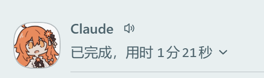
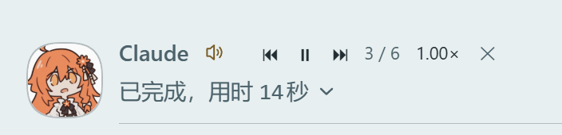
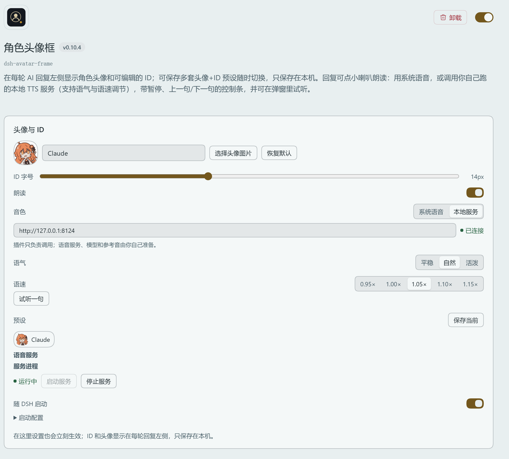
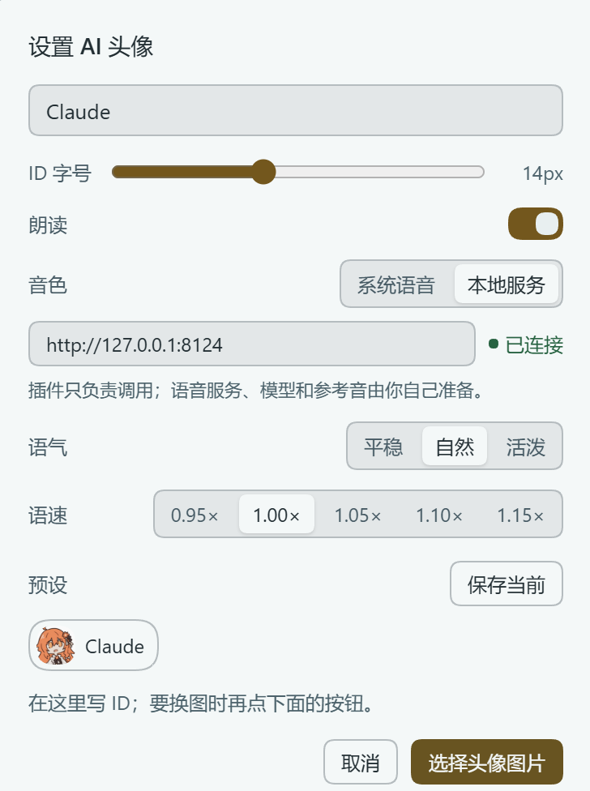
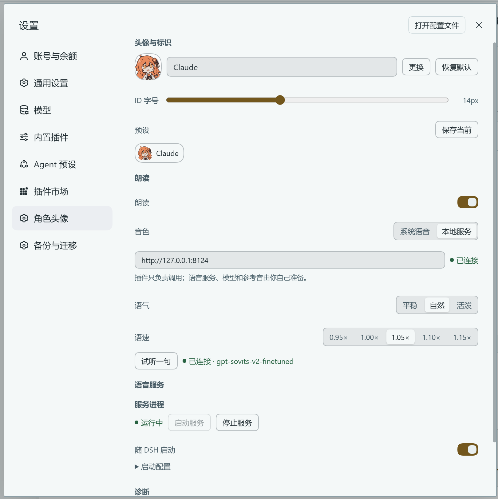
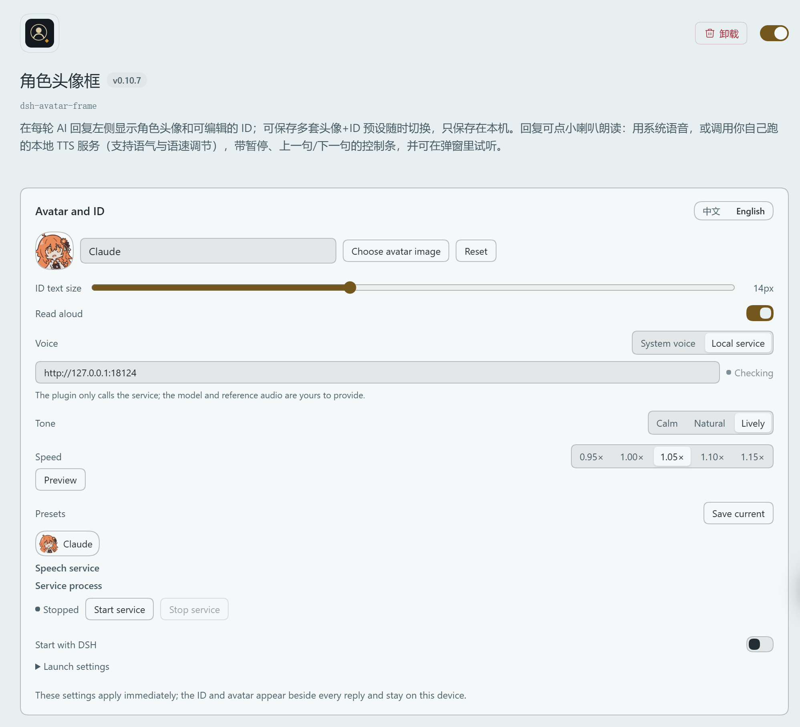
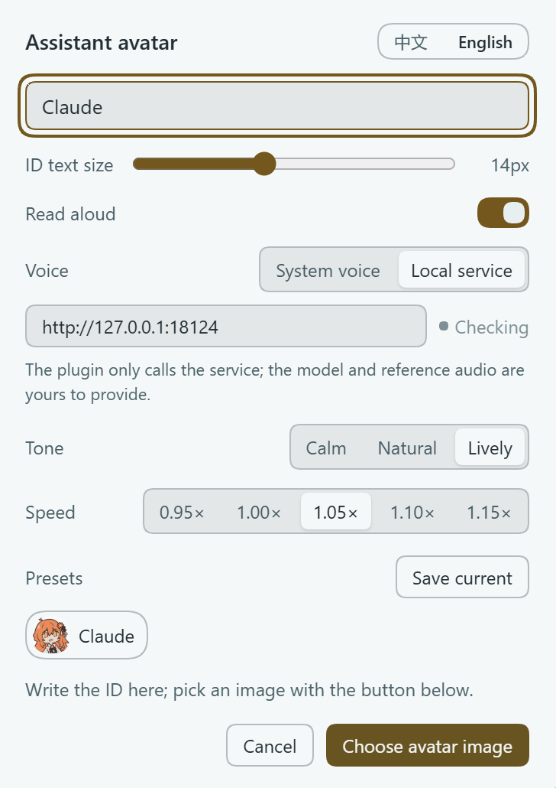
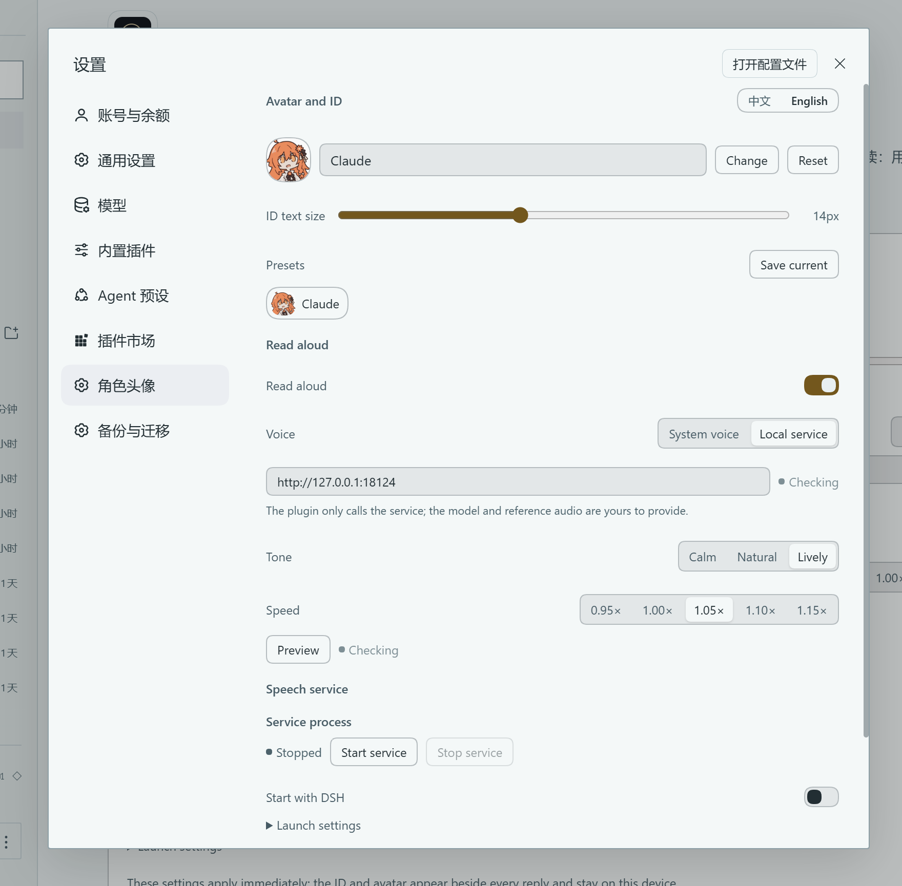

# 角色头像框 · dsh-avatar-frame

[中文](#中文) · [English](#english)

> DeepSeek Harness 的界面插件：在每轮 AI 回复左侧显示角色头像和可编辑的 ID，并可以把回复**朗读**出来——用系统语音，或者调用你自己跑的本地 TTS 服务；也可以在设置里一键启动、停止那个服务进程。
>
> 插件**不附带**任何语音模型、参考音频或服务；音色由你自己运行的服务提供，接口见 [docs/tts-contract.md](docs/tts-contract.md)。



---

## 中文

### 功能

**形象**

- 每轮 AI 回复左侧显示圆形头像，右边是可点击编辑的 ID，与「已完成，用时 …」那一行对齐；
- 上传图片 → 拖动/缩放裁切 → 应用到所有轮次；
- ID 字号可调（10–20px）；
- 预设：最多 8 套「头像 + ID + 字号」，一键切换；预设图压缩成 JPEG，不占空间。

**朗读**

- 点 ID 右侧的小喇叭，朗读这一条回复的正文（只读最终回答，不读思考过程和折叠的工具步骤）；
- 两种引擎：系统语音（开箱即用）或你自己的本地服务；
- 播放控制条：朗读时接在小喇叭右侧，可暂停/继续、上一句/下一句、五档语速（0.95× / 1.00× / 1.05× / 1.10× / 1.15×）、停止；
- 语气三档：平稳 / 自然 / 活泼，随请求发给你的服务；
- 试听：不用回到聊天，在设置里直接试一句；
- 失败提示：某句合成失败时，小喇叭旁出现红点，悬停可看原因；
- 长回复按句切分、提前两段预生成，句间不卡顿。



**其他**

- 设置 → **角色头像**：头像、ID、字号、预设、朗读、引擎、语气、语速、服务地址、试听、诊断都在这页；
- **语音服务进程**：一键启动/停止你自己配置的服务进程，可勾选「DSH 启动时拉起语音服务」（设置页与插件详情页都能操作）；切到「系统语音」时整块自动隐藏，进程仍在跑或开着自启时例外；
- 诊断信息：服务状态与模型名、上一句合成耗时、播放进度、最近一次错误；
- **界面语言可切换**：中文 / English 两个按钮，放在插件详情页、设置 → 角色头像、点头像弹出的面板三处；选择只记在本机，刷新/重启后保持；
- 所有数据只在本机 `localStorage`，不上传、不联网（除非你把服务地址指向远程）。

### 安装

1. 打开 DeepSeek Harness → **插件 → 添加插件** → 输入本插件的 **包名**（`dsh-avatar-frame`，从 npm 拉取，最省事）、**GitHub 仓库地址**（`https://github.com/vioeveann/dsh-avatar-frame`）或**本地目录路径**；
2. **重启一次 DSH**（必须）。安装、升级后都算：插件的前端模块和服务启动都在 DSH 启动时加载，只刷新页面往往不够，会出现「装上了、显示运行中，但聊天区没变化」。

包名已发布到 npm：[`dsh-avatar-frame`](https://www.npmjs.com/package/dsh-avatar-frame)（国内可走 `registry.npmmirror.com` 镜像）。

**装不上怎么办**

- 用 **GitHub 地址**安装走的是 `git`，机器连不上 github.com 就会报 `ERR_PNPM_GIT_RESOLVE_FAILED`。先验证：`git ls-remote https://github.com/vioeveann/dsh-avatar-frame`；不通就配代理，或在 `hosts` 里给 `github.com` 指定一个可用 IP；
- 完全绕开 `git` 和 npm：直接下载 [v0.11.5 源码 zip](https://github.com/vioeveann/dsh-avatar-frame/releases/latest) → 解压 → 添加插件时填**解压后的本地目录**（也可以走 `Code` → **Download ZIP**）；
- 用**包名**安装若提示找不到，先 `npm config get registry` 确认走的是官方源。



### 使用

1. 点任意一轮回复左侧的**头像**，或「已完成」那一行的 **ID**，打开设置面板；
2. 点「选择头像图片」上传图片，在裁切框里拖动、滚轮缩放，确定；
3. 在面板顶部的输入框里写 ID（角色名、代号都行），字号按需调；
4. 想留一套搭配就点「保存预设」，最多 8 套；
5. 需要朗读就把「朗读」打开，然后点回复旁边的小喇叭。



### 语音

插件本身**不下载模型、不附带参考音频、不启动任何服务**。它只做两件事：用系统语音读，或者调用你给的 HTTP 服务。

默认地址 `http://127.0.0.1:8123`，可在面板、插件详情页或设置页修改，旁边会显示「已连接 / 未连接」的实时状态。服务不可用时会自动退回系统语音；状态点在离线时**每 2.5 秒重试一次**，连上后每 30 秒静默保活一次，中途挂掉也会自己变红。

**先用一个示例跑通**：仓库里带了一个最小实现，用微软 Edge 的在线语音：

```bash
pip install edge-tts
python examples/simple_tts.py          # 监听 127.0.0.1:8123
```

然后把服务地址填成 `http://127.0.0.1:8123`，点小喇叭。想要自己的音色，把示例里的 `synthesize()` 换成你的引擎即可。

**一键启动服务（可选）**：插件的宿主端可以替你启动那个进程，入口两处——**设置 → 角色头像 → 语音服务**，以及**插件详情页**的同名区块。

- 「启动服务 / 停止服务」：执行你填的那条命令；
- 「DSH 启动时拉起语音服务」：DSH 启动时自动把它拉起来（不是开机自启）；
- 「启动配置」里填：**启动命令**、**工作目录**、**环境变量**（每行 `KEY=VALUE`）。

```
启动命令   "F:\tts\python.exe" server.py
工作目录   F:\tts
环境变量   HF_HOME=F:\tts\hf-cache
```

想直接用仓库里的示例服务试这个功能：`启动命令 = python examples/simple_tts.py`，`工作目录 = 本仓库所在目录`。

几点要说清楚：

- 命令是**你自己填的**，插件不附带任何服务；它只是替你执行、托管这个子进程；
- 进程生命周期跟随 DSH：DSH 退出时它会被一起收掉；「DSH 启动时拉起语音服务」只在 DSH 启动时执行一次；
- 端口上已经有服务在跑时（比如你手动开的），插件会显示「端口上已有服务（非本插件启动）」，不会重复启动；
- 宿主端代码在 DSH 启动时加载，**安装或升级插件后要重启一次 DSH**，这一块才可用；界面会提示「宿主端未加载」。

**接口契约**：完整说明见 [docs/tts-contract.md](docs/tts-contract.md)。

```
GET  /health
  -> 200 {"ok": true, "model": "任意字符串"}

POST /tts
  {"text": 要读的文本, "speed": 1.05, "tone": "normal"}
  -> 200，Content-Type 为音频（audio/wav、audio/mpeg 均可）
```

需要允许 CORS（`Access-Control-Allow-Origin: *` 并响应 `OPTIONS` 预检）。`tone` 是建议值，不认识就忽略；`speed` 范围 0.7–1.3。

**启动失败时先看这一条**：设置页「启动配置」下面会显示进程退出前的输出。如果看到

```
PermissionError: [WinError 10013] 以一种访问权限不允许的方式做了一个访问套接字的尝试
```

说明端口被 **Windows 的保留端口段**占住了（Hyper-V / WinNAT 会在重启后划走若干段，用 `netsh interface ipv4 show excludedportrange protocol=tcp` 查看）。换一个不在保留段里的端口（例如 18124），服务端和插件地址一起改即可。

### 设置与数据

入口：**设置 → 角色头像**。所有设置都存在本机浏览器的 `localStorage`：

| 键 | 内容 |
| --- | --- |
| `dsh-avatar-frame/image/v1` | 头像图片（data URL） |
| `dsh-avatar-frame/id/v1` | ID 文本 |
| `dsh-avatar-frame/size/v1` | ID 字号 |
| `dsh-avatar-frame/presets/v1` | 预设列表 |
| `dsh-avatar-frame/speech/v1` | 朗读开关 |
| `dsh-avatar-frame/engine/v1` | 引擎（`system` / `clone`） |
| `dsh-avatar-frame/endpoint/v1` | 服务地址 |
| `dsh-avatar-frame/rate/v1` / `tone/v1` | 语速 / 语气 |
| `dsh-avatar-frame/lang/v1` | 界面语言（`zh` / `en`，不写则跟随 DSH） |

同一个浏览器的多个窗口之间会同步。换电脑、清缓存会丢，插件没有云同步。



### 已知限制

- **只支持 Web 平台的 DeepSeek Harness**；
- 插件接管了「已完成，用时 …」这一行的渲染。**停用或卸载插件后请刷新一次界面**，否则这一行会显示「未知 surface 事件：turn-process」；
- 头像只在**一轮结束后**出现，流式输出过程中没有——那需要接管整个回答渲染器，代价太大；
- 与**同样接管 `turn-process`** 的其他插件会冲突；
- 朗读按句切分，某一句失败会跳过继续读；
- 插件的前端模块与「一键启动服务」的宿主端代码都在 **DSH 启动时**加载：**安装或升级后必须重启 DSH**，只刷新页面可能没反应；
- 该功能会**按你填写的命令执行本机程序**，请只填你自己的服务；路由走本机同源请求，没有额外鉴权，别把 DSH 暴露到公网；
- 英文界面下「试听一句」会读英文例句，中文音色念英文可能带口音——那是模型的能力边界。

### 目录结构

```
.
├── package.json          # bundle 元信息与前端入口声明
├── cordis.patch.yml      # 插件装配
├── index.js              # 宿主端：语音服务的启动/停止与配置（同源路由）
├── client.js             # 前端：界面、播放、设置页（单文件、无构建）
├── locale/               # zh / en 文案与插件描述
├── icon.svg
├── README.md
├── CHANGELOG.md
├── LICENSE
├── docs/                 # 接口契约、截图、发布步骤
└── examples/simple_tts.py
```

`client.js` 无构建、无依赖（React 由宿主提供），改完刷新即可；`index.js` 只在 DSH 启动时加载。发布流程见 [docs/releasing.md](docs/releasing.md)。

### 许可

代码以 [MIT](LICENSE) 发布。插件**不包含**任何语音模型、参考音频或音色文件；你用到的模型、参考音频、第三方语音服务的许可与版权需自行确认，请勿把他人声音素材随本插件分发。

---

## English

> An avatar frame and read-aloud plugin for **DeepSeek Harness**: a character portrait and an editable ID beside every assistant reply, with read-aloud through the system voice or **your own** local TTS service — the plugin can also start and stop that process for you.
>
> It ships **no** voice model, **no** reference audio and **no** service. Your voice comes from a service you run; the contract is in [docs/tts-contract.md](docs/tts-contract.md).

### Features

**The frame**

- A round avatar in the gutter of every settled reply, with an editable ID aligned to the "Completed in …" row;
- Upload an image, drag/zoom to crop, apply it to every turn;
- ID text size adjustable (10–20px);
- Up to 8 saved presets of "avatar + ID + size"; preset images are stored as compressed JPEG.

**Read aloud**

- Click the speaker next to the ID to read the reply's final answer only (not the thinking or collapsed tool steps);
- Two engines: the system voice, or your own local service;
- Playback bar beside the speaker: pause/resume, previous/next sentence, five speeds (0.95×–1.15×), stop;
- Three tone presets (calm / natural / lively) sent to your service;
- Preview the voice from the settings page without touching the chat;
- Failure dot next to the speaker with the reason on hover;
- Long replies are split by sentence and pre-generated two chunks ahead, so playback stays continuous.

**The rest**

- Settings → **Character avatar** holds everything: avatar, ID, size, presets, read-aloud, engine, tone, speed, endpoint, preview, diagnostics;
- **Service process**: start/stop your own TTS process and optionally start it with DSH (available on both the settings page and the plugin page);
- Diagnostics: service state and model name, last synthesis time, playback progress, last error;
- **Chinese / English UI switch** on the plugin page, the settings page and the avatar popup; the choice is stored locally;
- Everything is kept in this browser's `localStorage`; nothing is uploaded unless you point the endpoint at a remote host.

### Install

1. Open DeepSeek Harness → **Plugins → Add plugin** → enter this plugin's **package name** (`dsh-avatar-frame`), its **GitHub URL** (`https://github.com/vioeveann/dsh-avatar-frame`), or a **local directory path**;
2. **Restart DSH** (required). This applies to installs and upgrades alike: both the client module and the service launcher load at DSH startup, and a page refresh alone is usually not enough — otherwise you get "installed and running, but the chat row looks unchanged".

The package is published on npm as [`dsh-avatar-frame`](https://www.npmjs.com/package/dsh-avatar-frame) — installing by that name is the simplest route.

**If installation fails**

- Installing from a **GitHub URL** goes through `git`; if your machine can't reach github.com it fails with `ERR_PNPM_GIT_RESOLVE_FAILED`. Check with `git ls-remote https://github.com/vioeveann/dsh-avatar-frame`, then use a proxy or point `github.com` at a reachable IP in your hosts file;
- To bypass `git` and npm entirely: download the [source zip from the latest release](https://github.com/vioeveann/dsh-avatar-frame/releases/latest), unzip it, and point "Add plugin" at the unzipped **local directory** (the `Code` → **Download ZIP** route works too);
- If the **package name** isn't found, check `npm config get registry` — it must be the official registry.



### Usage

1. Click the **avatar** left of any reply, or the **ID** in the "Completed in …" row, to open the panel;
2. Choose an image, then drag and zoom in the crop stage;
3. Type the ID and pick a text size;
4. Optionally save the combination as a preset (up to 8);
5. Turn on "Read aloud" and click the speaker next to a reply.



### Speech service

The plugin never downloads a model or bundles a voice. It either uses the system voice or calls an HTTP service you provide. The default address is `http://127.0.0.1:8123` and can be changed in the panel, the plugin page or the settings page; a status dot shows connected / not connected and **retries every 8 seconds**, so start the service and watch it turn green — no refresh needed.

**Try it with the bundled example** (Microsoft Edge online voices):

```bash
pip install edge-tts
python examples/simple_tts.py          # listens on 127.0.0.1:8123
```

Point the plugin at `http://127.0.0.1:8123` and click the speaker. To use your own voice, replace `synthesize()` in that file with your engine.

**One-click service start (optional).** The host half can launch the process for you; the same block exists in **Settings → Character avatar → Speech service** and on the plugin page:

- Start / Stop service — runs the command you configure;
- Start the speech service with DSH — launches it once at DSH startup (not an OS autostart);
- Launch settings — the command, the working directory, and `KEY=VALUE` environment lines.

The command is yours: the plugin does not ship a service, it only executes and supervises that child process. Its lifetime follows DSH, and if something is already listening the plugin says so instead of starting a second copy.

**Contract**: `GET /health` → `{"ok": true, "model": "..."}`; `POST /tts` with `{"text", "speed", "tone"}` → audio (`audio/wav` or `audio/mpeg`). CORS with an `OPTIONS` preflight is required. Full details: [docs/tts-contract.md](docs/tts-contract.md).

### Settings and data

Settings → **Character avatar**. Every key lives in this browser's `localStorage`: `image`, `id`, `size`, `presets`, `speech`, `engine`, `endpoint`, `rate`, `tone`, `lang` — all under the `dsh-avatar-frame/…/v1` prefix. Windows of the same browser stay in sync; clearing site data resets it, and there is no cloud sync.



### Known limitations

- **Web platform only**;
- The plugin replaces the renderer for the "Completed in …" row, which is how the avatar fits in the left gutter — **refresh once after disabling or uninstalling it**, otherwise that row shows "unknown surface event: turn-process";
- The avatar appears only after a turn finishes; streaming turns have none (that would require replacing the whole answer renderer);
- Conflicts with other plugins that also replace `turn-process`;
- Read-aloud is split by sentence; a failed sentence is skipped;
- The service launcher's host code loads at DSH startup, so **restart DSH after upgrading the plugin**;
- That feature **runs local programs with the command you type** — only point it at your own service; the route is same-origin on your machine and has no extra auth, so don't expose DSH to the internet;
- In the English UI the preview reads an English sentence; a Chinese-trained voice will carry an accent — that is the model, not the plugin.

### License

[MIT](LICENSE). The repository contains no voice model, reference audio or voice data; licenses for the models, audio and services you use are your responsibility.
